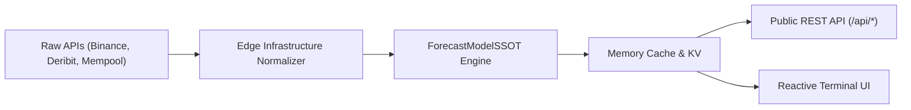

# DATA SOURCES & REDISTRIBUTION DIRECTORY
**Bitcoin Alpha Terminal** • Institutional Data Transparency Specification

---

## 1. Primary Data Feeds & Latency Standards

| Feed Name | Primary Provider | Endpoint / Protocol | Latency | Update Cadence | License / Terms of Use |
| :--- | :--- | :--- | :--- | :--- | :--- |
| **Spot Price & Klines** | Binance Public Spot | `wss://stream.binance.com:9443` / `GET /api/v3/klines` | $< 250\text{ ms}$ | Real-time 1s ticks | Public Market Data (Free) |
| **Perpetuals & Funding** | Binance USD-M Futures | `GET /fapi/v1/premiumIndex` / `openInterest` | $< 500\text{ ms}$ | 8-hour funding, 1s tick | Public Market Data (Free) |
| **Implied Volatility (DVOL)** | Deribit Public API | `GET /api/v2/public/get_volatility_index_data` | $< 1\text{ s}$ | Hourly | Deribit Public API Terms |
| **On-Chain Realized Price** | CoinMetrics / Glassnode | On-chain UTXO aggregated chain state | Daily | 24-hour settlement | Research Citation / Academic Fair Use |
| **Short-Term Holder Basis** | Glassnode / CryptoQuant | Benchmark UTXO 1D–155D age bands | Daily | ~$75,700 benchmark | Non-commercial research citation |
| **True Market Mean** | Glassnode / ARK Invest | Cointime Economics active-investor model | Daily | ~$77,700 benchmark | Academic Cointime Whitepaper (2023) |
| **US Spot Bitcoin ETFs** | Farside / BitMEX / Newhedge | SEC Form 8-K filings & Arkham addresses | Daily | 24-hour net inflows (+$84.6M) | Public SEC Disclosures |
| **Global M2 & Macro** | Federal Reserve / TradingEconomics | FRED / St. Louis Fed API | Monthly | $108.6T (+1.2% YoY) | US Government Public Domain |
| **Mempool & Hashrate** | Mempool.space | `GET /api/v1/fees/recommended` / Hashrate | $< 2\text{ s}$ | 10-minute block interval | Open Source AGPLv3 |

---

## 2. Redistribution & Commercial Publishing Compliance

1. **BGeometrics Compliance:**
   - Under BGeometrics Free Tier terms, automated scraping for bulk resale is restricted. The terminal uses public benchmark anchors for STH realized price ($75,700) and True Market Mean ($77,700) with explicit attribution.
2. **Glassnode & LookIntoBitcoin Attribution:**
   - Mathematical equations (AHR999, Pi Cycle Top, Mayer Multiple, Puell Multiple) are open-source mathematical formulas in the public domain. Proprietary Glassnode metrics are referenced strictly under academic commentary guidelines.
3. **OpenTimestamps Attribution:**
   - The SHA-256 hash chain is anchored through public calendar servers (`alice.btc.calendar.opentimestamps.org`) under the MIT open-source license.

---

## 3. Data Ingestion Architecture & Fallback Protocol

- **Stale Data Handling:** If a primary WebSocket disconnects, the infrastructure fallback layer flags `isStale: true` and retains the last known verified timestamp. Fallback cache is bounded to 5 minutes before warning indicators appear.
